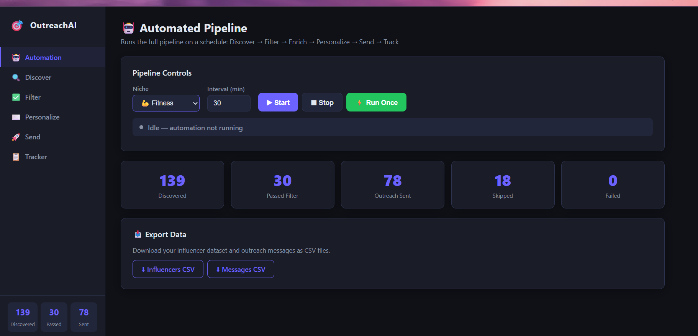
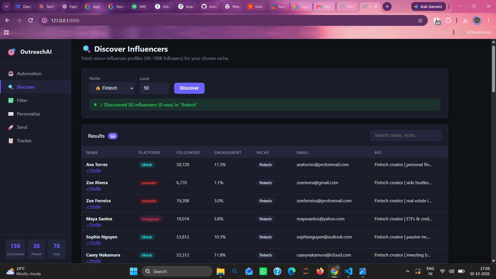
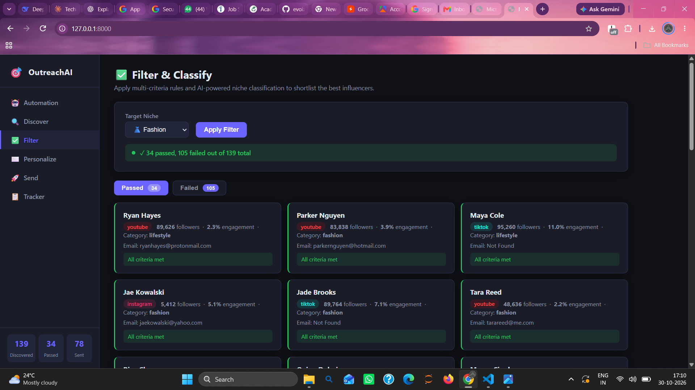
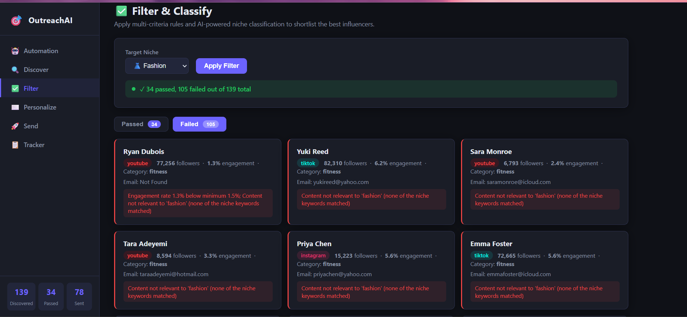
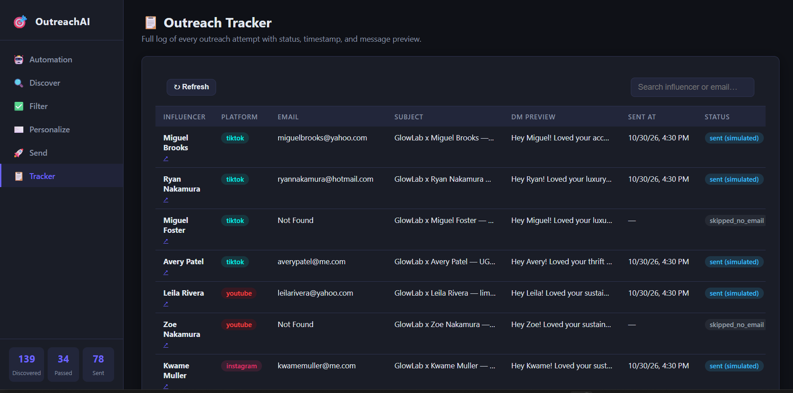

# 🎯 Automated Micro-Influencer Outreach System

A complete, end-to-end pipeline that **discovers** micro-influencers, **filters and classifies** them, **enriches** their profiles, **generates personalized** AI outreach messages, and **sends / tracks** the outreach — all with optional full automation on a configurable schedule.

---

## Table of Contents

1. [Technology Stack](#technology-stack)
2. [Project Structure](#project-structure)
3. [Setup Instructions](#setup-instructions)
4. [Data Sources & Discovery Methodology](#data-sources--discovery-methodology)
5. [Filtering Logic](#filtering-logic)
6. [Enrichment Process](#enrichment-process)
7. [AI Personalization](#ai-personalization)
8. [Sending Mechanism](#sending-mechanism)
9. [Automation](#automation)
10. [API Reference](#api-reference)
11. [Limitations](#limitations)
12. [Scalability](#scalability)

---

## Technology Stack

| Layer | Tool / Library |
|---|---|
| **Backend** | Python 3.11+, FastAPI, Pydantic v2 |
| **Database** | SQLite (WAL mode, foreign keys enabled) |
| **LLM** | Groq API (`llama-3.3-70b-versatile`, free tier) |
| **Web Enrichment** | httpx (website scraping for email lookup) |
| **Real Discovery** | Apify (`apify/instagram-hashtag-scraper`) |
| **Scheduler** | APScheduler (BackgroundScheduler) |
| **Retry Logic** | tenacity (exponential back-off) |
| **Notifications** | Slack SDK (incoming webhooks) |
| **Email Sending** | Python smtplib / SMTP with STARTTLS |
| **Automation Alt** | n8n workflow (`n8n_workflow.json`) |
| **Frontend** | Vanilla HTML + CSS + JavaScript (no framework) |

---

## Project Structure

```
influencer_outreach_system/
├── backend/
│   ├── main.py              # FastAPI application + all API endpoints
│   ├── automation.py        # Pipeline orchestrator + APScheduler
│   ├── filtering.py         # Multi-criteria filter & niche classifier
│   ├── enrichment.py        # Profile enrichment (email extraction, normalisation)
│   ├── personalization.py   # Groq LLM + template fallback message generator
│   ├── sending.py           # SMTP + simulate sending + outreach log
│   ├── database.py          # SQLite init + connection helper
│   ├── models.py            # Pydantic data models
│   ├── config.py            # Environment variable loader
│   ├── notifier.py          # Slack webhook notifications
│   ├── requirements.txt     # Python dependencies
│   ├── .env.example         # Environment variable template (no real keys)
│   └── discovery/
│       ├── base.py          # Abstract adapter interface
│       ├── mock_adapter.py  # Deterministic mock data (no API key needed)
│       └── apify_adapter.py # Real Instagram data via Apify
├── frontend/
│   ├── index.html           # Single-page dashboard
│   ├── style.css            # Dark/light responsive theme
│   └── script.js            # Pipeline UI logic
├── n8n_workflow.json        # Optional n8n automation workflow
└── README.md
```

---

## Setup Instructions

### 1. Clone / unzip and install dependencies

```bash
cd backend
pip install -r requirements.txt
```

### 2. Configure environment variables

```bash
cp .env.example .env
# Edit .env with your values:
nano .env
```

Minimum required for basic operation (mock data, no real email sending):

```dotenv
GROQ_API_KEY=your_groq_api_key_here   # free at https://console.groq.com
GROQ_MODEL=llama-3.3-70b-versatile
DATA_SOURCE=mock
SEND_MODE=simulate
```

For real data + real sending:

```dotenv
DATA_SOURCE=apify
APIFY_TOKEN=your_apify_token_here      # free tier at https://console.apify.com

SEND_MODE=smtp
SMTP_HOST=smtp.gmail.com
SMTP_PORT=587
SMTP_USER=your_email@gmail.com
SMTP_PASS=your_gmail_app_password      # Gmail → Security → App Passwords
```

### 3. Start the server

```bash
cd backend
uvicorn main:app --reload --port 8000
```

### 4. Open the dashboard

Navigate to **http://localhost:8000** in your browser.

### 5. Run the pipeline

**Option A — Manual (step by step via UI):**
1. Click **Discover** → choose niche → click Discover
2. Click **Filter** → apply criteria
3. Click **Personalize** → preview AI messages
4. Click **Send** → send / simulate outreach
5. Check **Tracker** for full log

**Option B — Automated:**
- Click **Automation** → choose niche + interval → **▶ Start**
- Or use the n8n workflow: import `n8n_workflow.json` into your n8n instance

---

## Data Sources & Discovery Methodology

### Mock Adapter (default, no API key needed)

Generates **300 deterministic, fictional influencer profiles** covering all 9 niches. Uses `hashlib.md5` seeding so the same niche always yields the same profiles across runs, making `INSERT OR IGNORE` deduplication correct. Names are human-readable (no numeric suffixes). Emails use real-looking domains (`gmail.com`, `outlook.com`, etc.) with ~25% `None` (representing influencers with no public email).

Best for: development, testing, demonstration.

### Apify Adapter (real data)

Uses the `apify/instagram-hashtag-scraper` actor to search Instagram by niche-specific hashtags:

| Niche | Hashtags searched |
|---|---|
| fitness | `fitnessmotivation`, `homeworkout`, `fitlife` |
| beauty | `skincareroutine`, `makeuptutorial`, `cleanbeauty` |
| fashion | `ootd`, `streetstyle`, `sustainablefashion` |
| … | (see `discovery/apify_adapter.py`) |

The adapter deduplicates by profile URL, skips anyone outside 5K–100K followers, and passes `None` for contact email (enrichment handles email lookup separately).

---

## Filtering Logic

Implemented in `filtering.py`. Each influencer is evaluated against **3 criteria**:

### Rule 1 — Follower count
Must be within the micro-influencer range: **5,000 – 100,000**. Exact limits per niche can be adjusted in `CATEGORY_RULES`.

### Rule 2 — Engagement rate
Minimum threshold varies by niche and platform:
- Parenting: ≥ 2.5% (highly engaged communities)
- Fitness / Crypto / Gaming: ≥ 2.0%
- Beauty / Lifestyle: ≥ 1.8%
- Fashion / Fintech / Technology: ≥ 1.5%

### Rule 3 — Content relevance
A keyword dictionary per niche is checked against the influencer's niche field, content themes, bio, and recent post caption. An influencer passes this check if at least one keyword matches.

Each influencer receives:
- `passed_filter`: `True` / `False`
- `filter_reason`: Human-readable explanation, e.g. `"All criteria met"` or `"Followers 3,400 below minimum 5,000; Engagement rate 1.2% below minimum 2.0%"`
- `category`: Best-matching niche category (keyword frequency scoring)

---

## Enrichment Process

Implemented in `enrichment.py`. Runs on every shortlisted influencer (both passed and failed, so emails are available even for filtered-out influencers).

### Email extraction (3-step cascade)

1. **Bio text parsing** — regex scan of the influencer's bio for email addresses, handling common obfuscation patterns (`[at]`, `(dot)`, etc.)
2. **Recent post caption** — same regex applied to the latest post caption (many creators put their booking email in captions)
3. **Website scraping** — if the influencer has a linked website, the homepage and `/contact` page are fetched via `httpx`. Scans for `mailto:` links and bare email addresses in the first 20KB of HTML.

If no email is found by any method: marked as `"Not Found"` (never invented or guessed).

### Other normalisation
- `engagement_rate`: defaults to `0.0` if null
- `content_themes`: falls back to `[niche]` if empty
- `audience_age/gender/geography`: set to `"Unknown"` rather than invented values

---

## AI Personalization

Implemented in `personalization.py`.

### Primary: Groq API
- **Model**: `llama-3.3-70b-versatile` (free tier, ~6,000 tokens/min)
- **Temperature**: 0.75 (creative but consistent)
- **Response format**: `json_object` (structured output)

The prompt includes: influencer name, platform, niche, content themes, recent post caption, follower count, engagement rate, audience demographics, brand name, brand context (tailored per niche), and a rotating collaboration type.

**Collaboration types rotate** across influencers so consecutive pitches vary:
1. Paid UGC content creation
2. Brand ambassador programme
3. Affiliate partnership (15% commission)
4. Sponsored post + Story series
5. Product seeding / barter
6. Co-created limited-edition product

**Word count enforcement**: `_trim_to_range()` truncates or extends messages to stay within the spec (60–90 words for email, 15–30 words for DM) without fabricating content.

### Fallback: Rule-based template
Used when `GROQ_API_KEY` is not set or the API call fails. Still personalized — uses the influencer's name, themes, caption, audience, geography, and the rotating collaboration type. Falls back gracefully with no user-visible error.

---

## Sending Mechanism

Implemented in `sending.py`.

### Simulate mode (default)
Records outreach as `sent (simulated)` with full message content in the database. No emails are actually sent. Safe for testing.

### SMTP mode
Set `SEND_MODE=smtp` in `.env`. Sends via `smtplib` with `STARTTLS`. Works with Gmail App Passwords, Outlook, or any SMTP server.

### Duplicate prevention
Before sending, the system checks `outreach_log` for an existing record with `(influencer_id, platform='email')`. If found, the influencer is skipped with status `skipped`. This UNIQUE constraint is also enforced at the database level.

### Outreach log fields
`influencer_id`, `platform`, `email`, `email_subject`, `email_body`, `dm_text`, `sent_at`, `status`, `error_message`

Statuses: `sent`, `sent (simulated)`, `skipped`, `skipped_no_email`, `failed`

---

## Automation

### APScheduler (built-in)
- Start via UI: **Automation → ▶ Start** (configurable niche + interval in minutes)
- Or via API: `POST /api/automation/start?niche=fitness&interval_minutes=30`
- Runs the full pipeline: Discover → Filter → Enrich → Personalize → Send
- Idempotent: duplicate influencers and duplicate outreach are silently skipped
- Retry: each stage retries 3 times with exponential back-off on `ConnectionError` / `TimeoutError`
- Slack notification sent after each pipeline run (if `SLACK_WEBHOOK_URL` is configured)

### n8n workflow
Import `n8n_workflow.json` into your n8n instance. Connects to the FastAPI endpoints via HTTP Request nodes on a 30-minute schedule. No additional configuration needed beyond running the backend.

---

## API Reference

| Method | Endpoint | Description |
|---|---|---|
| `POST` | `/api/discover` | Discover influencers (`?niche=fitness&limit=50`) |
| `POST` | `/api/filter` | Filter + enrich (`?niche=fitness`) |
| `POST` | `/api/personalize` | Preview AI messages (no send) |
| `POST` | `/api/send` | Send / simulate outreach |
| `GET`  | `/api/log` | Full outreach tracker log |
| `GET`  | `/api/stats` | Pipeline summary statistics |
| `POST` | `/api/automation/start` | Start scheduler (`?niche=&interval_minutes=`) |
| `POST` | `/api/automation/stop` | Stop scheduler |
| `POST` | `/api/automation/run-once` | Run pipeline once immediately |
| `GET`  | `/api/automation/status` | Scheduler status + next run time |
| `GET`  | `/api/export/influencers.csv` | Download influencer dataset |
| `GET`  | `/api/export/messages.csv` | Download outreach messages |

---

## Limitations

1. **Mock data** — The default `mock` adapter generates fictional influencer profiles with `@gmail.com` / `@outlook.com` style emails and plausible but invented bios. Use `DATA_SOURCE=apify` for real Instagram data.

2. **Instagram DM automation** — Instagram's platform policies prohibit automated DM sending via unofficial APIs. The system generates personalized DMs and displays them in the UI and outreach log, but **does not auto-send them**. DMs must be sent manually or via Meta's official Business API (requires approved access).

3. **Email enrichment coverage** — The enrichment module only finds emails that are publicly listed in bios, captions, or linked websites. It does not use paid email-lookup services (Hunter.io, Apollo). Real-world email discovery rates on public Instagram profiles are typically 20–40%.

4. **Apify free tier limits** — The Apify free tier includes ~$5/month of compute. The `apify/instagram-hashtag-scraper` typically uses $0.10–0.50 per 100 profiles, so the free tier supports approximately 1,000–5,000 profile discoveries/month.

5. **Groq rate limits** — The free tier allows ~6,000 tokens/minute. For large batches (200+ influencers), the personalization step may throttle. The system handles Groq errors gracefully by falling back to the template generator.

6. **SQLite concurrency** — SQLite with WAL mode is sufficient for single-server deployments. For multi-worker or high-concurrency setups, migrate to PostgreSQL by replacing `database.py`.

---

## Scalability

To scale from 50 to 500+ influencers:

- **Discovery**: Increase `limit` parameter up to 200 per call; add multiple Apify actor runs for different hashtags
- **Database**: Replace SQLite with PostgreSQL (`asyncpg` + `databases` library)
- **Personalization**: Use Groq's batch endpoint or add a rate-limit-aware queue (e.g. `asyncio.Semaphore`)
- **Sending**: Switch to a transactional email service (SendGrid, Mailgun, AWS SES) for high-volume sending
- **Scheduling**: Replace APScheduler with Celery + Redis for distributed task execution
- **Deployment**: Dockerize the FastAPI backend; deploy on Railway, Render, or AWS ECS

## Application Screenshots

### 1. Main Dashboard



### 2. Influencer Discovery



### 3. Filtering and Classification





### 4. AI Email Personalization


### 5. Instagram DM Generation


### 6. Outreach Tracker



### 7. Automation Workflow

